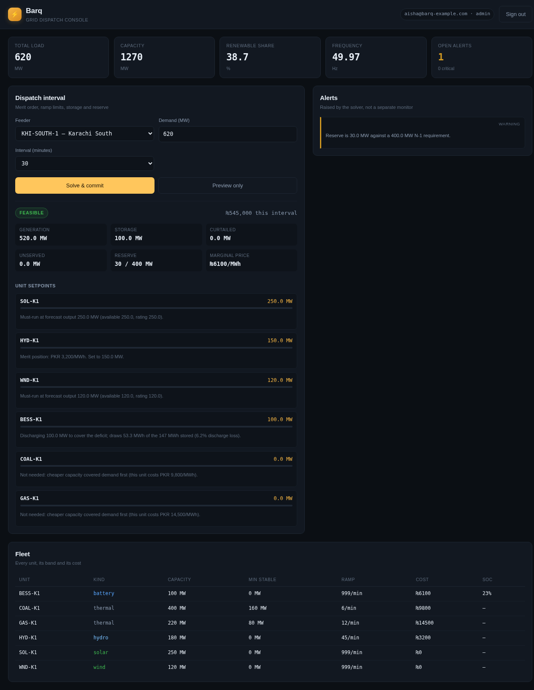
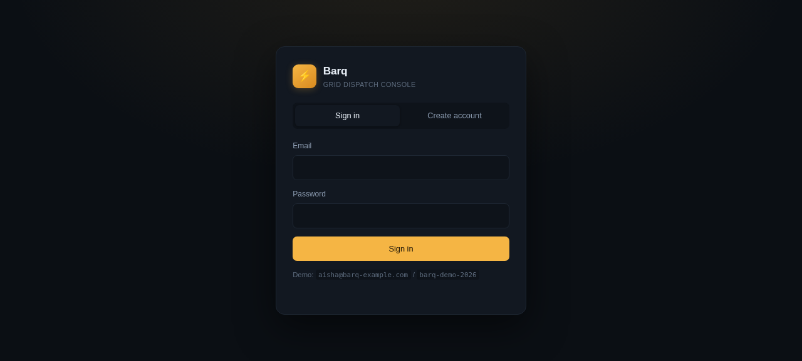
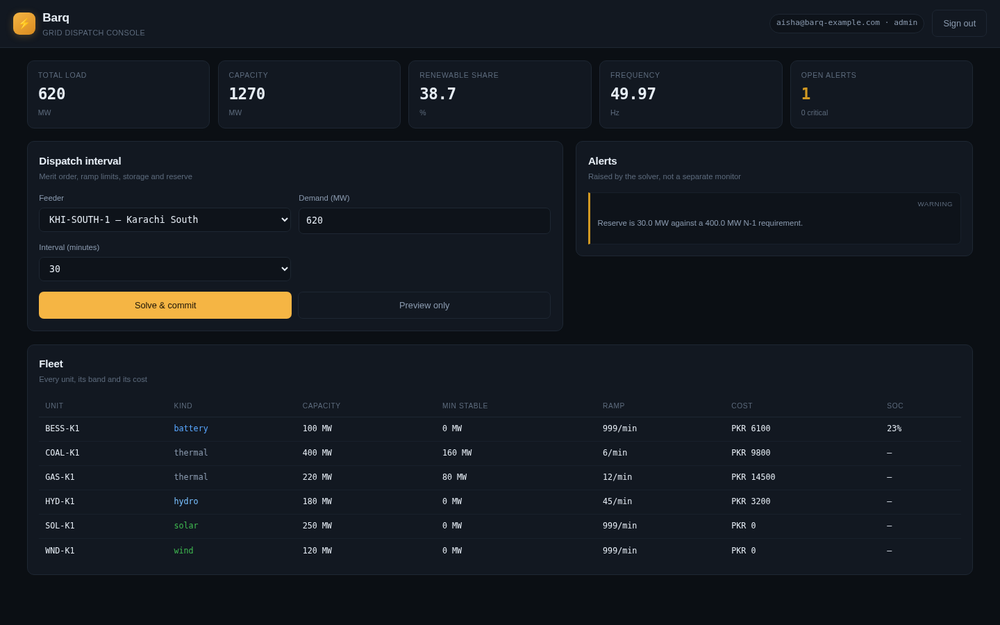
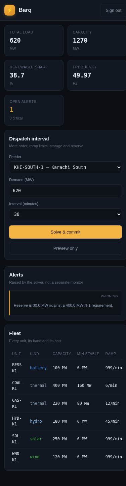

# Barq ⚡

**A grid dispatch console that explains every number it gives you.**

Barq takes a distribution feeder — its generators, its battery, its demand — and
works out what each unit should be set to for the next interval. Then it tells
you *why*, in a sentence, for every single one.

Most dispatch tools hand you a table of setpoints and leave you to trust it. When
a number looks wrong you have no way in. Barq's whole design is the opposite: a
dispatcher who disagrees with a setpoint can read the reason and see exactly
which constraint to argue with.



---

## What it actually does

**Merit-order dispatch.** Units are committed cheapest-first by marginal cost.
Hydro at PKR 3,200/MWh runs before coal at PKR 9,800, which runs before the gas
peaker at PKR 14,500.

**Ramp limits, in both directions.** A 400 MW coal block at 300 MW cannot drop
to zero in fifteen minutes. At 6 MW/min it can reach 210, and that is where it
goes. The floor is *forced* output — which is why a grid with plenty of cheap
capacity can still show over-generation.

**Minimum stable load.** A coal unit cannot run at 20 MW. If the gap is smaller
than its 160 MW floor, Barq commits it at the floor and reports the excess as
real over-generation rather than pretending the arithmetic works.

**Storage arbitrage.** Batteries charge from renewable surplus *before* anything
is curtailed — throwing away free energy a battery could have stored is the
wrong order of operations. Discharge is limited by both power rating and stored
energy, with round-trip efficiency applied.

**Curtailment.** When renewables exceed demand and the batteries are full, the
surplus is curtailed and reported as a number, not hidden.

**Reserve adequacy.** Spinning reserve counts headroom on units that are
*actually running*, and only as much as they can reach inside the reserve
window. A cold 400 MW block is not 400 MW of reserve.

**Frequency response.** Deviation from 50 Hz is converted to a droop-based
correction, so the plan shows what the fleet would do if frequency moved.

---

## Screenshots

| Sign in | Console |
|---|---|
|  |  |

| Dispatch result | Mobile |
|---|---|
|  |  |

---

## Live demo

**Not deployed.** There is no `VERCEL_TOKEN` in the build environment, and Vercel
is the wrong host for this anyway — Barq wants a persistent database and a
long-running process, neither of which a serverless platform gives you. The
intended path is `docker compose up --build`, which takes about a minute. See
[Deployment](#deployment).

---

## Quick start

```bash
git clone https://github.com/mohdabrarbaloch-arch/day-28-barq.git
cd day-28-barq

python -m venv .venv
source .venv/bin/activate          # Windows: .venv\Scripts\activate

pip install -e ".[dev]"

cp .env.example .env
python -c "import secrets; print('SECRET_KEY=' + secrets.token_urlsafe(48))" >> .env

python -m scripts.seed             # demo feeder, six units, one admin account
uvicorn app.main:app --reload
```

Open <http://127.0.0.1:8000> and sign in as:

```
aisha@barq-example.com
barq-demo-2026
```

That account is the admin. Registering a second account gives you a viewer, so
you can see the role gates working.

### With Docker

```bash
cp .env.example .env
# set SECRET_KEY in .env
docker compose up --build
```

Postgres comes up with the app, migrations run on boot, and the console is on
<http://127.0.0.1:8000>.

---

## The demo grid

`scripts/seed.py` builds a plausible Karachi South feeder:

| Unit | Kind | Capacity | Min stable | Ramp | Cost (PKR/MWh) |
|---|---|---|---|---|---|
| COAL-K1 | thermal | 400 MW | 160 MW | 6/min | 9,800 |
| GAS-K1 | thermal | 220 MW | 80 MW | 12/min | 14,500 |
| HYD-K1 | hydro | 180 MW | 0 | 45/min | 3,200 |
| SOL-K1 | solar | 250 MW | 0 | — | 0 |
| WND-K1 | wind | 120 MW | 0 | — | 0 |
| BESS-K1 | battery | 100 MW | 0 | — | 6,100 |

At 620 MW of demand with 310 MW of renewable potential, the solver produces:

- **520 MW** of generation, **100 MW** from storage, **0 MW** unserved
- **110 MW curtailed** — the coal is stuck at 210 MW by its ramp limit and the
  battery is full, so the surplus has nowhere to go
- **30 MW of reserve** against a 400 MW requirement, which raises a critical
  alert

That last line is the honest one. The grid is short of reserve because coal and
gas are offline, and Barq says so instead of reporting a comfortable pass.

---

## API

Full reference in [`docs/api.md`](docs/api.md). The shape:

```
POST   /api/auth/register          create an account (first one is admin)
POST   /api/auth/login             get a JWT
GET    /api/auth/me                current user

GET    /api/feeders                list feeders
POST   /api/feeders                create (admin)
GET    /api/feeders/{id}/assets    units on a feeder
POST   /api/assets                 create a unit (admin)

POST   /api/telemetry              ingest a reading
GET    /api/telemetry/{asset_id}   read history

POST   /api/dispatch               solve and persist
POST   /api/dispatch/preview       solve without writing
GET    /api/dispatch/{id}          read a stored plan

GET    /api/alerts                 open alerts
POST   /api/alerts/{id}/acknowledge  (admin)
GET    /api/dashboard              grid summary
```

Every dispatch response carries, per unit:

```json
{
  "asset_code": "COAL-K1",
  "setpoint_mw": 210.0,
  "was_ramp_limited": true,
  "reason": "Merit position: PKR 9,800/MWh. Set to 210.0 MW. Ramp-limited: 6.0 MW/min allows 90 MW of movement this interval, so the target was clamped."
}
```

---

## Testing

```bash
pytest -q          # 77 tests, no network
ruff check .       # lint
ruff format --check .
```

The solver tests are the interesting ones. They assert the physics, not the
implementation: that a ramp limit applies downwards, that a cold unit
contributes no reserve, that storage charges before curtailment, that a
round-trip efficiency of 0.88 means 100 MWh in gives 88 MWh out.

---

## Deployment

### Docker Compose (recommended)

```bash
cp .env.example .env
python -c "import secrets; print('SECRET_KEY=' + secrets.token_urlsafe(48))" >> .env
docker compose up --build -d
```

### Any container host

The image is a standard Python 3.11 slim build. Set `DATABASE_URL`,
`SECRET_KEY` and `ENVIRONMENT=production`, expose port 8000, and put a reverse
proxy in front for TLS.

### Why not Vercel

Barq needs a persistent database and a process that stays up. Serverless
functions give you neither, and the SQLite fallback would lose data between
invocations. If you want a managed host, use one that runs containers — Fly.io,
Railway, Render, or a small VPS.

---

## Project layout

```
app/
  api/          HTTP routers (auth, grid)
  core/         config, database, security, middleware, types
  models/       SQLAlchemy models
  schemas/      Pydantic request/response models
  services/     dispatch.py (pure solver), grid_service.py (DB layer)
  static/       index.html, styles.css, app.js — no build step
scripts/        seed.py
tests/          77 tests
docs/           setup, usage, API reference, screenshots
```

---

## Licence

MIT — see [LICENSE](LICENSE).

---

Built as day 28 of a 30-day AI engineering challenge. The interesting part was
not the merit order — that is a sort. It was the ramp limit, and specifically
the discovery that modelling it in only one direction lets a coal plant
teleport.
